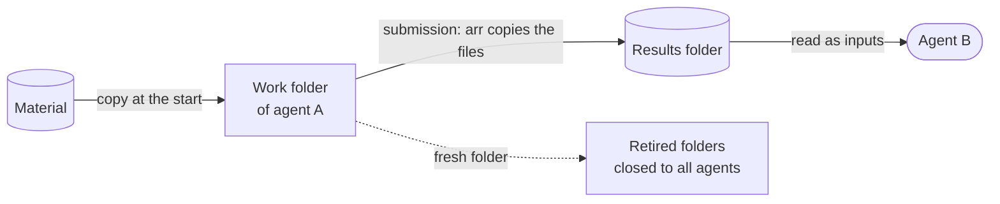
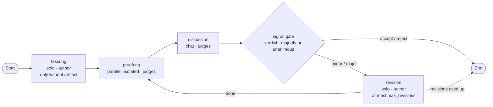
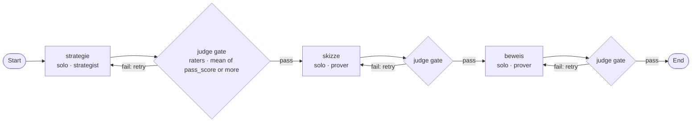
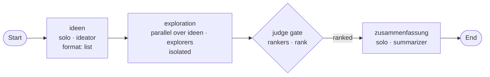
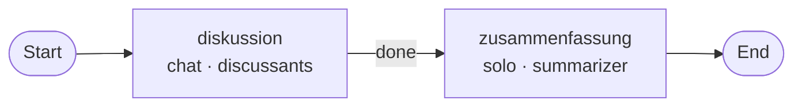
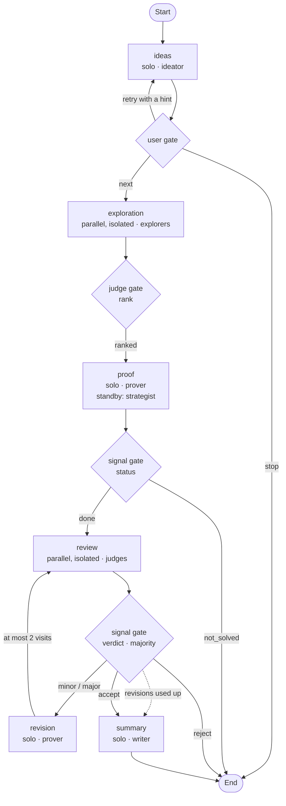

# Research groups: agents, phases, actions and gates

> **Status: design, partly built.** `arr` ships four group start skills built from this model: `proof-review`, `proof`, `exploration` and `roundtable` (see [The start skills](#the-start-skills)). The five older fixed group types (`solo`, `roundtable`, `waterfall`, `review`, `exploration`) are gone: every run is a phases run (see [Old topologies](#old-topologies)). This document describes the model, so that you can compose your own groups from the same parts. It records where the design is going, not only what the code does today. The notation of the group file is settled for the first version. Built so far: the submission tool with its formats and checks, the result folder with versions and diffs, the group file itself (its model, the checks and the estimate of turns), the folders (scratch folder, fresh work folders with retired ones, an agent's own record closed to it), the renewal of a full context with a handover note (see [Context](#context)), which already works in the five fixed group types, and the phase runner for phases with the topologies `solo`, `parallel`, `chat` and `moderated` (actions, assignments of a lead, `over`, `repeat`, isolated phases, gates with routes, inputs, channels per phase, the private channel to you, agents on standby, `folder: fresh` and `context: compact`), and `decider: user` for a phase or an agent (see [The supervising agent](#the-supervising-agent)). Votes in channels and the moderator tools are gone for all runs; gates read submissions. The phase runner has been tested with a test backend only, not yet with real models. The GUI shows runs and skills with phases: the phase plan as a table (skills page, run detail, run-start card), a progress bar over loops with the result of each pass, usage and the estimate per phase, the fill level of each agent's context, submissions under „Ergebnisse“, gate `user` and escalations with a hint field, and the private channel of each agent as „privat · <agent>“. Claude Code gets the same plan from `describe_skill` and `estimate_run` and the JSON Schema of a group from `group_schema`. Sealed submissions and the private note `note_next` are hidden in „Ergebnisse“ and in `read_results`, but an agent's transcript keeps every `submit` call in full, also for Claude Code (`read_transcript`); this limit is open. The GUI does not list the assignments of a lead yet; their turns and the log show them.

## The idea

A research group is a set of **agents** and a list of **phases**. Each phase says who takes part, what each agent has to do, who can talk to whom, and when the run moves on.

```
Run
├── Agents        who: engine, model, rights, role
├── Channels      how messages travel: group chat or direct channel
├── Folders       how files travel: work folders and the results folder
└── Phases        in order, connected by routes
    ├── Topology  solo | parallel | chat | moderated
    ├── Agents    with an action · on standby · not taking part
    ├── Actions   for each agent a task and a submission
    ├── Context   keep | reset | compact
    ├── Channels  which ones are open in this phase
    └── Gate      when the phase ends and where the run goes: done | signal | judge | user
```

Every agent works the same way. It gets an **action**: a task that says what to do, and a submission that it hands in at the end, in a format `arr` can read. A summarizer, a judge or a rater is not a special kind of agent. It is an agent whose action asks for a particular submission.

## Agents and roles

An agent has an `id`, an engine (Claude or ChatGPT; in the group file `provider: claude` or `provider: codex`), a model, its rights (tools, web, read folders, work folder) and a **role**. The role is a short, static text: who the agent is and what standard it applies. What the agent does in a given phase is not part of the role. That is the action.

## Actions

An **action** is what one agent does in one phase. It has two parts:

| Part | What it is | Example |
|---|---|---|
| **Task** | what the agent is asked to do | "Check the proof step by step. Write down every gap as an objection." |
| **Submission** | what the agent hands in at the end, in a format `arr` checks | a `review`: a verdict and a list of objections |

The task is for the agent. The submission is for everything that comes after it: gates, overviews and the inputs of later phases read submissions, never free text.

### Task

The task is a text file in the group (`tasks/<name>.md`). It says what to do in this phase, while the role says who the agent is. `arr` adds the context: the research question of the run, the phase, the inputs from earlier phases and, on a retry, the feedback.

An action can take several turns. If a turn ends without a submission, for example because the agent is waiting for a long computation, `arr` starts the next turn of the same action. The number of turns per action is limited (`turns`, three unless the action says otherwise).

### Submission

The agent hands in its submission through a tool. `arr` checks the fields at once. If they do not fit, the agent gets an error and corrects them, so a submission always has valid fields. The check is about the form, not the quality: "not solved" is a submission, and so is a proof that later fails a gate.

If the agent stops without a submission, or the turns of the action are used up, `arr` asks once. After that the action counts as `not_solved`.

Every submission has the same head:

| Field | Content |
|---|---|
| `status` | `done` or `not_solved`. "Not solved", with a reason, is a valid submission. |
| `summary` | One to three sentences. Used in overviews, by gates and as the default input of later phases. |
| `body`, `files` | The content itself: text, files from the agent's work folder, or both. |
| `note_next` | Optional note to the agent's future self, used when its context is compacted. |

The format adds its own fields:

| Format | Extra fields | Used for |
|---|---|---|
| `text` | – | notes, summaries |
| `artifact` | none, but `files` are required | a proof, a script, a data set |
| `review` | `verdict` (`accept`, `minor`, `major`, `reject`), `objections` | judges |
| `rating` | `score`, `criteria`, `comment` | raters, rankers |
| `list` | `items` | a list of ideas |
| `decision` | `choice` from the options the phase names | branching |

A submission can have a **name** (`name: proof`). Submissions under the same name are versions of the same thing: `arr` keeps every version, writes a diff from the second one on, and later phases always get the newest.

## Folders

Messages travel through channels. Files travel through folders. A run has these kinds:

| Folder | What it is | Who writes | Who reads | How long it lives |
|---|---|---|---|---|
| **Material** | the project as it was when the run started. Per agent also the read folders you allowed. | nobody | every agent; a read folder only the agents it is set for | the run |
| **Work folder** | the desk of one agent: notes, scripts, drafts | that agent | only that agent | until the agent gets a fresh one |
| **Scratch folder** | throwaway data of one agent: downloads, intermediate results | that agent | only that agent | until the agent gets a fresh work folder, at the latest until the run ends. Then it is deleted. |
| **Results folder** | every submission of the run | only `arr` | every agent, and you | as long as you keep the run |

Every agent has exactly one work folder at a time. It starts as a copy of the project or empty. Several agents can also have one work folder in common, a **shared folder**: a desk for agents that work on the same files. A shared folder lives for the whole run. It fits agents that build on each other's files and talk to each other, for example one that writes a script and one that tests it. Agents that should work independently keep their own folders and exchange submissions. Today a shared folder is for agents of one engine only (see [SECURITY.md](../SECURITY.md)).

Agents never write into the results folder. When an agent submits, `arr` copies the files the submission names from the work folder into the results folder. What lies there is not changed afterwards: a new version is added next to the old one. A submission that fails a gate stays there too.



A file gets from one agent to another in three ways:

| Way | Used for |
|---|---|
| in a **submission** | the normal way. `arr` checks it and keeps versions, and an isolated phase holds it back until the phase ends. |
| as an **attachment** to a message | a quick exchange in a channel. `arr` stores it with the channel, and only the members of the channel can read it. |
| through a **shared folder** | several agents edit the same files. Not allowed between the agents of an isolated phase. |

An agent can never open another agent's work folder or scratch folder.

### Folders that expire

A work folder does not have to last for the whole run. A phase can give an agent a **fresh** work folder: a new copy of the project, or a new empty folder. Two things then happen to the old one:

- `arr` **retires** the work folder. No agent can read a retired folder, not even the agent that worked in it. It stays in the record of the run, with a diff of what the agent changed, until you slim the run.
- `arr` **deletes** the scratch folder. Nothing of it is kept.

Transcripts are record as well: an agent cannot read its own.

So the rule for agents is simple: **work folders expire, submissions stay.** What an agent wants to keep, it hands in. What nobody needs afterwards belongs in the scratch folder.

By default the work folder follows the `context` setting of the phase (see [Context](#context)): `reset` gives a fresh folder, because notes on the desk are memory too, and `keep` and `compact` leave the folder alone. A phase can set the two apart with `folder: keep` or `folder: fresh`:

| Setting | Effect | Example |
|---|---|---|
| `context: reset` | new session, fresh folder | A judge reviews the second version of a proof. Its private notes from the first review are gone. What it handed in is still in the results folder. |
| `context: reset`, `folder: keep` | new session, same folder | A prover starts over after a long computation and keeps its scripts and data. |
| `folder: fresh` | same session, fresh folder | A worker on standby gets ten computations from a lead. It remembers what it learned, but every computation starts in a clean folder. |

A shared folder never becomes fresh, because that would take the work away from the others. For an agent in a shared folder, `reset` renews only the session.

After the run, slimming deletes the work folders, retired folders, the agents' temp folders and the copy of the project. The results folder, the transcripts, the chats with their attachments and the diffs (also those of the retired folders) stay. Nothing flows back into your project by itself: you take over what you want from the results folder.

## Phases

### Topology

| Topology | What happens | Example |
|---|---|---|
| `solo` | One agent with one action. | A prover writes a proof. |
| `parallel` | Several agents, each with its action, at the same time. With `isolated: true` they see each other's submissions only after the phase, every channel they share with another agent is closed, and no agent can be on standby. With `over: <list>`, `arr` deals the entries of a list out to them, one action per entry. With `repeat: N` every action runs N times in a row, and the latest submission counts. | Judges review independently. |
| `chat` | The agents discuss in a channel, in rounds or event-driven, and each one submits. An agent can submit again during the discussion; its newest submission counts. The discussion ends when all have submitted and no direct message is unread, when the rounds are used up, or when the channel has fallen silent. Whoever has not submitted by then is asked once. | Judges discuss their reviews. |
| `moderated` | One lead has the action. The others are on standby. The lead hands out actions at run time: it writes the task and names the format of the submission. The submissions go back to the lead, and the phase ends with the lead's own submission. If the lead submits while actions it handed out are still running, `arr` first names them; a second submission cancels them and ends the phase. | A coordinator splits a problem into computations. |

An agent works on one action at a time. If it has several in one phase, for example three entries of a list or five actions from a lead, it does them one after the other, in the order of the list or in the order the lead handed them out.

### Assignments in a `moderated` phase

One agent, the lead, has the action; the others are on standby (`standby`) and receive assignments from it. `max_assignments` (required) limits the assignments per pass.

```yaml
- name: split
  topology: moderated
  max_assignments: 4
  actions:
    coordinator: { task: tasks/split.md, submission: { format: text } }
  standby: [helper-*]
```

The lead calls `assign(agent, task, format)` with an agent on standby, the text of the assignment and the format of its submission (`text`, `artifact`, `review`, `list` or an own format of the group). One agent works its assignments one after the other; different agents work at the same time. Each recipient gets up to three turns and one follow-up question, like any action, and hands in with `submit`. Its submission comes back to the lead: the lead gets a turn with the summary and the path in the results folder, and these return turns do not count against the lead's `turns`. The lead names a recipient as its context lists it (an alias, if the agent has one in an anonymous channel).

The phase ends with the lead's submission. If the lead asked you something and its turns run out, the phase waits for your answer, until five minutes after the question; after your answer the lead gets a turn and can still hand out assignments. If assignments still run or wait when the lead hands in, `arr` names every one of them once and does not accept the submission; the next `submit`, with no new assignment in between, is accepted, cancels them and ends the phase. Only the lead's submission counts for the gate and for later phases; the submissions of the assignments are in the results folder.

Known limit: aliases are unique only per channel. Two agents on standby that are each the first member of an anonymous channel of their own both appear as „Mitglied A“ to a lead outside those channels, and the lead cannot give either of them an assignment (`assign` refuses the name and says so). Put such agents into one anonymous channel instead of one each, or put the lead into one anonymous channel with them. An ordinary channel shared with the lead does not help, and neither does an extra anonymous channel listed after their own ones.

Not in this version: a recipient giving assignments itself, showing a submission in a channel, the assignments in the GUI.

The estimate counts for a `moderated` pass the lead's `turns` plus one, and per assignment its turns, one follow-up and one return turn. It does not count the note turn of auto-compact, turns after an answer of yours, or wake-ups through an agent's private channel; `turns_per_agent` stays the hard limit.

### Who takes part

In each phase an agent is one of three things:

- **With an action:** it has a task and must submit.
- **On standby (a sleeper):** it has no action of its own. It wakes up when someone addresses it through a channel or a lead hands it an action, does that, and sleeps again. It never holds up the end of the phase.
- **Not taking part:** it gets no turn and no messages.

### Inputs

Inputs are what the agents of a phase get from earlier phases. By default these are the research question of the run and, for every submission so far, its summary and its place in the results folder. A phase can choose differently: only certain phases or names, the full text instead of the summary, the history of a channel, or the best-rated submission of a phase.

Inputs decide what `arr` puts in front of an agent. They are not a wall: every agent of the run can read the results folder, except for submissions that an isolated phase still holds back.

### Channels

A group defines its channels once: a group chat with several members or a direct channel between two agents. Each phase names the channels that are open; all others are closed while it runs. A message in an open channel reaches a working agent as a hint. An agent on standby is woken only by a message addressed to it: `@name`, a question to it, or a reply to its message. It answers and goes back to standby. The raters of a gate do not wake agents on standby. An agent that is a member of an open channel but takes no part in the phase gets nothing and finds the messages unread later.

In a `chat` phase the agents with an action discuss in the first channel the phase names, with that channel's pacing (`rounds` or `event`). `rounds` of the phase is the number of rounds with `rounds` and the number of idle rounds with `event`. An agent that has handed in and has no open question to another agent in the discussion gets no further round; a question it asked an agent on standby does not keep it in.

Every agent also has a private channel to you, `user.<agent-id>`. `arr` sets it up by itself, it is open in every phase, also in an isolated one, and for other agents it does not exist. Through it an agent can ask you a question, which appears in your inbox. A note you write there reaches the agent and wakes it if it is on standby.

How questions to you work today:

- An agent that hands in is done. An open question to you is closed with its submission, and a later answer changes nothing.
- If an agent uses up its turns without handing in while a question to you is open, the phase waits up to five minutes for your answer, and your answer gives the agent one more turn.
- An agent that needs your answer is told to wait for it with `wait_until` for up to five minutes; an answer, a note or a question of yours in its private channel ends the wait at once. If it hands in instead, the question counts as settled.
- A question from you in the private channel wakes an agent on standby, also without `@name`.
- A note that neither replies to the question nor names the agent (`@name`) does not count as the answer to an open question.

### Context

| Value | Session | Work folder |
|---|---|---|
| `keep` (default) | continues. The agent remembers everything. | stays |
| `reset` | new. The agent gets only its role, the action and the inputs. | fresh |
| `compact` | new, and starts with the agent's own `note_next`. | stays |

`context` and `folder` are set on a phase, for all its agents or for single ones. They apply at the start of each action, also of one that a lead hands out. On a `retry` the agent continues with its session and its folder. [Folders that expire](#folders-that-expire) explains the fresh work folder.

Independently of phases, `arr` measures how full each agent's context is. When it reaches the agent's threshold (`compact: { at: 60% }` by default: a share of the context window or a number of tokens, settable in `arr.yaml`, for a group and for single agents), `arr` asks the agent for a short handover note between two turns and starts a new session. That note turn counts as a turn, in usage, cost and `turns_per_agent`. `arr` then puts back what it knows itself, in front of the next prompt: the running action, the agent's own submissions with their paths, its open questions to you and its note. Role and project context come with the new session, unread messages with the inbox. The note goes to no other agent. While it writes the note, the agent cannot use the group chat tools: it cannot submit, post, ask, wait or read messages until its next turn. `at: 100%` turns this off; the engine's own compaction stays as a safety net. This renewal never touches the folders.

## Gates and routes

The **gate** of a phase decides when the phase ends and where the run goes next. It reads fields of submissions.

| Gate | Who decides | Results | Example |
|---|---|---|---|
| `done` (default) | Nobody. The phase ends when every agent with an action has submitted. | `done` | a summary |
| `signal` | The agents themselves, through a field of their submission. With several submissions a rule applies: `all` or `any` for `status`, `majority` or `unanimous` for any field with fixed values. | the values of the field | A prover reports `not_solved`, and the run goes back to the strategy. |
| `judge` | Agents that did not take part in the phase. After the work each of them gets one rating action and rates every submission of the phase in it, never its own. A rule turns the ratings into a result (`mean` with a pass score, `rank`, `majority`). | `pass` or `fail` for a pass score, `ranked` for `rank`, the verdict for `majority` | Two raters score a proof sketch. |
| `user` | You. The run pauses and shows you the summaries. | the route you choose | You look at the strategy before the prover starts. |

If a rule finds no majority, the stricter value counts: one judge says `accept` and one says `minor`, so the result is `minor`. That works for verdicts, which have an order. For a field without an order, for example the `choice` of a `decision`, the gate must name a route `on_tie`; `arr` rejects the group otherwise.

The names can mislead. In the `review` template the judges are ordinary agents of the phase, and a `signal` gate reads their verdicts. A `judge` gate brings in agents from outside the phase:

```yaml
gate:
  type: judge
  raters: [rater-*]
  action: { task: tasks/rate.md, submission: { format: rating } }
  rule: mean
  pass_score: 7
  routes: { pass: next, fail: retry }
```

The scale and the criteria of ratings are set once for the group (`rubric`). A gate sets its own pass score and can name its own criteria.

Each result of a gate has a **route**:

| Route | Effect |
|---|---|
| `next` | the next phase in the list |
| `retry` | the same phase again. The agents get the feedback: the comments of the raters or the objections of the judges. |
| `goto: <phase>` | another phase, forward or back. Its inputs include the submissions that led there, for example the reason of a `not_solved`. |
| `stop` | the run ends with what it has |
| `escalate` | you decide, as with the `user` gate, but only in this case |

Every loop is bounded. A phase in a loop has a maximum number of visits (`max_visits`); the first visit and every retry count. If a route leads into a phase whose visits are used up, the run takes the route `on_exhausted` of that phase instead. `arr` rejects a group in which a loop has no limit.

If the visits are used up after a `judge` gate with a pass score and the run goes on, the best-rated version counts, not the last one.

There is one exception to the limit. When you yourself choose "one more attempt", at a `user` gate or after `escalate`, the phase gets exactly one more visit, also beyond `max_visits`. The limits and the budget of the run still apply.

## The start skills

`arr` ships four group start skills: `proof-review`, `proof`, `exploration` and `roundtable`. Each is a group with `topology: phases`, with its phases, a task file per action under `tasks/` and static roles. A comparison with fake agents checked every old group type against the start skill that replaces it: the same turns, inputs, channels, submissions, routes, results and end of the run, except named, intended differences. The recorded runs of the old types stay as test data, so the start skills are still checked against them. For example, in `exploration` a silent explorer is asked again after each repetition; in `roundtable` the summarizer no longer takes part in the discussion and every discussant hands in a conclusion; a single judge in `proof-review` gets one discussion turn alone; `reject` ends a `proof-review` run; raters see only the submission they rate. A proof from the project (`artifact`) and given ideas (`ideas`) reach every phase that needs them.

Parameters were renamed where the old value was an expression: `proof` uses `max_attempts` (1 + reworks) and `on_fail: next | stop | escalate`, `proof-review` uses `judge_memory: reset | keep` (`reset` also gives the judges a fresh work folder), and the summary of `exploration` and `roundtable` is switched off with `summarizer: none`. `solo` has no start skill.

In the diagrams a box is a phase (its name in the file, topology, who), a diamond is a gate, and an arrow is a route.

### proof-review

Independent judges review a proof, discuss and reach a verdict. The author revises until the judges accept or the revisions are used up. Without a proof from the project (`artifact`) the author writes it first. With `discussion_rounds: 0` the judges decide without a discussion, in the phase `pruefung-allein`.



### proof

Strategy, sketch and proof in order. Raters score each stage, and below the pass score its author reworks it. After `max_attempts` the group goes on with the best attempt, stops or asks you (`on_fail`).



### exploration

An ideator proposes ideas, or you give them with `ideas`. Explorers work them out, rankers order the results, and a summarizer sums up. `exchange` sets what the explorers see of each other: nothing (`none`), excerpts of the others (`digest`), or a channel to talk in (`channel`).



### roundtable

The discussants talk in one channel, and each hands in a conclusion. Then the summarizer writes the summary.



### Updating start skills

`arr skills update` brings every start skill in `skills/` that you never changed to the version of your `arr`: it compares the folder byte for byte with every version `arr` shipped since the start skills exist. A skill you changed, also one with your own files beside the shipped ones, is left as it is and named in the output; a missing one is not created again (use „Start-Skills anlegen“ for that). The button „Start-Skills aktualisieren“ on the skills page does the same; it appears only when a start skill equals an earlier shipped version. Runs keep the copy of the skills they started with.

### Old topologies

Since wave 4b every run is a phases run (`topology: phases`). The five old topologies (`solo`, `roundtable`, `waterfall`, `review`, `exploration`) are gone. A `group.yaml` or `run.yaml` that names one is refused everywhere (CLI, GUI, Claude Code, the skills page) with the same message; it names the start skill to take as a template (for `solo`, an example with one phase). Old, finished runs stay readable in the GUI and through `read_results`.

A run without a skill is a phases run of one agent `solver` with one phase `arbeit`; its short task comes from `arr` itself. The name `tasks/ohne-skill.md` is reserved for it: a project file with that name is not used. A new group skill from the GUI is the smallest phases group: two participants discuss in `#runde`, and each hands in a text.

## A custom group

The same parts combine into groups that fit a problem. Here you check the ideas before the explorers start, the prover can ask a strategist on standby, and judges review the proof:



## What a group file looks like

A review group in this notation (simpler than the start skill `proof-review`):

```yaml
kind: research-group
version: 1
topology: phases

agents:
  - { id: author, role: roles/author.md, model: claude-opus-5-5 }
  - { id: judge, role: roles/judge.md, count: 2,                 # judge-1, judge-2
      mix: [{ provider: claude }, { provider: codex }] }
  - { id: summarizer, role: roles/summarizer.md, model: claude-haiku-5-5 }

channels:
  - { name: judges, members: [judge-*], mode: rounds, anonymous: true }

phases:
  - name: draft
    topology: solo
    actions:
      author: { task: tasks/draft.md, submission: { format: artifact, name: proof } }

  - name: review
    topology: parallel
    isolated: true
    context: reset                 # new session and a fresh work folder
    actions:
      judge-*: { task: tasks/review.md, submission: { format: review } }

  - name: discussion
    topology: chat
    channels: [judges]
    rounds: 1
    actions:
      judge-*: { task: tasks/discuss.md, submission: { format: review } }
    gate:
      type: signal
      field: verdict
      rule: majority
      routes:
        accept: { goto: summary }
        minor: { goto: revision }
        major: { goto: revision }
        reject: stop

  - name: revision
    topology: solo
    max_visits: 2
    actions:
      author: { task: tasks/revise.md, submission: { format: artifact, name: proof } }
    on_exhausted: next             # third revision asked for: go on to the summary
    gate: { type: done, routes: { done: { goto: review } } }

  - name: summary
    topology: solo
    actions:
      summarizer: { task: tasks/summarize.md, submission: { format: text } }
```

Each entry under `actions` is one action: the agent, its task and its submission.

`arr` checks a group file and reports errors with the path, the reason and a suggestion, for example a route to a phase that does not exist or a loop without a limit. Today the check runs on the skills page; once the runner is there it also runs before every start.

Some details of the notation:

- A value can be a whole placeholder such as `rounds: "{{ params.rounds }}"`. That works for numbers, choices and names; keys cannot be placeholders.
- `groupchats` is read as the older spelling of `channels`. A file that uses both is rejected.
- Defaults: the gate `done` with the route `next`, `turns: 3`, `rounds: 3` in a `chat` phase, `context: keep`.
- A phase is dropped when its `when` does not hold or none of its agents with an action is active. A route to a dropped phase goes to the next phase that exists.
- `max_visits: 0` is allowed. The phase is never entered, and a route to it takes `on_exhausted` at once.
- The format `rating` belongs to the rating action of a `judge` gate and cannot be used in an ordinary action.
- An input from a channel is always the full text of the channel.

## The supervising agent

The supervising agent is not part of any phase. It has no role, no action and no channel. For the whole run it decides the agents' permission requests within the mandate you wrote, for example a single `pip install` from PyPI. Everything else goes to you or is denied. You set it in the settings of your `arr` workspace (`arr.yaml`) or per run, outside the phases:

```yaml
approvals:
  decider: gatekeeper_then_user   # user | gatekeeper | gatekeeper_then_user
  gatekeeper: { model: claude-haiku-5-5, mandate: mandates/standard.md }
```

A phase or a single agent can tighten this with `decider: user`: you then decide every request in that phase, or of that agent, yourself, and the supervising agent never sees it. With `decider: gatekeeper_then_user` you also see what the mandate check found, for example that a host is not in the mandate. With `decider: gatekeeper` you stand exactly where the model would be asked: a request outside the mandate is still denied at once, and only what lies within it comes to you. This setting can only tighten, never loosen, and there is one mandate for the whole run.

In the terminal of `arr run` the card says, in German, why such a request is with you: it names the phase and the pass, or the agent's own setting. The inbox of the web interface says the same („Warum bei dir“).

The run-start card shows the phase plan with the decider of every phase and agent. If a request from Claude Code removes a `decider: user` that the skill sets with the defaults of its parameters, the card lists it as a sensitive deviation („Verschärfung aufgehoben“).

Three things sound alike and are different:

| Who | Decides | Where it is set |
|---|---|---|
| Supervising agent | whether an agent **may** do something, within your mandate | `approvals`, per workspace or run |
| `judge` gate | whether a result is **good enough**, and where the run goes | the gate of a phase |
| You | run starts, anything outside the mandate, agents' questions, the `user` gate | the inbox in the web interface |

## Limits of the model

The model is small on purpose. It cannot express the following:

| Limit | Meaning | What to do instead |
|---|---|---|
| One phase at a time | Agents work side by side inside a phase, but two phases never run at the same time. | Put both jobs into one `parallel` phase. They then share its gate. |
| No nesting | A phase cannot contain a group, and an agent on standby cannot hand out actions itself. | One `moderated` phase per level. |
| Fixed cast | All agents are set up before the run starts. A run cannot add agents. | `over` deals a list out to the agents that exist. |
| Agents are named in the plan | A phase names its agents. It cannot say "the author of the best attempt revises it". | A fixed agent takes over the best attempt as its input. |
| No teams | Two sub-groups cannot discuss separately in the same phase without seeing each other's results. | One `chat` phase per team, one after the other. The second team could still look up the results of the first (see [Inputs](#inputs)). |
| One model per agent | An agent keeps its engine and its model for the whole run. | Two agents. The second gets the submission of the first. |
| Rights per run | Tools, web access and read folders are set per agent for the whole run, not per phase. | – |
| No machine check as a gate | Gates read submissions. `arr` does not run a proof checker or a test itself. | An agent runs the check and reports the result in its submission. |
| No resume after a restart | If `arr` stops or is restarted during a run, the run ends as interrupted. It does not continue from the last finished phase. | Start the run again. The results folder of the interrupted run stays. |

## What does not change

Phases change the order of work, not the walls around it. Each agent runs in its sandbox and cannot read other agents' work folders. Work is exchanged only through channels, submissions and the shared folders the group names. Approvals, limits, the budget and the kill switch apply to the whole run. Usage is counted for the whole run and also shown per phase. See [SECURITY.md](../SECURITY.md).
