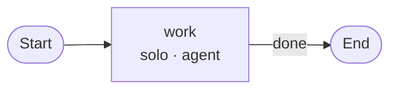
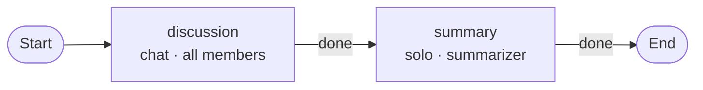
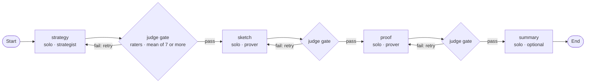
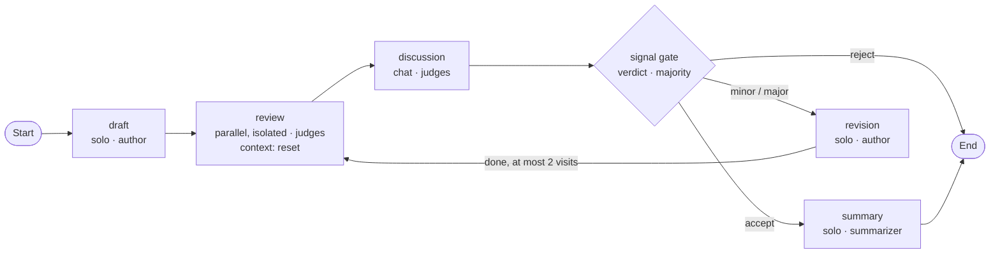
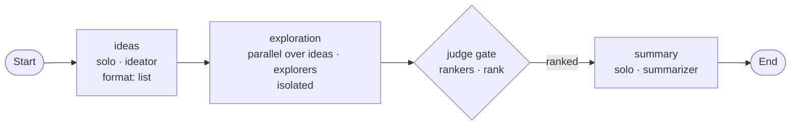
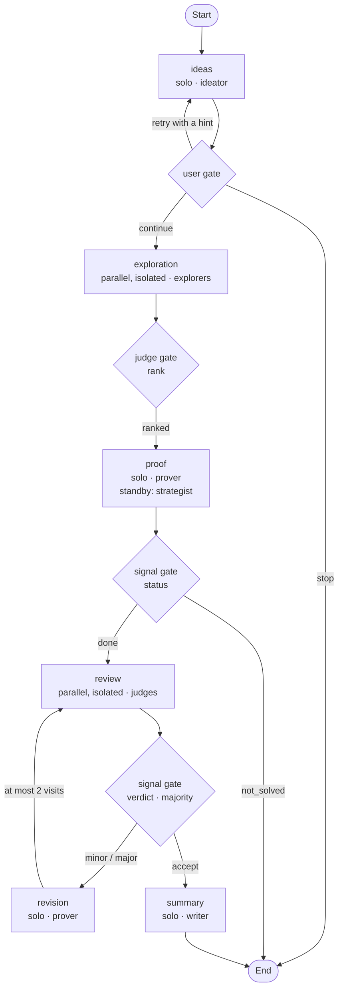

# Research groups: agents, phases, actions and gates

> **Status: design.** Today `arr` ships five fixed group types (`solo`, `roundtable`, `waterfall`, `review`, `exploration`). This document describes the model they are being rebuilt on, so that you can compose your own groups from the same parts. The YAML shown here is a sketch; key names may still change.

## The idea

A research group is a set of **agents** and a list of **phases**. Each phase says who takes part, what each agent has to do, who can talk to whom, and when the run moves on.

```
Run
├── Agents        who: engine, model, rights, role
├── Channels      who can talk to whom: group chat or direct channel
└── Phases        in order, connected by routes
    ├── Topology  solo | parallel | chat | moderated
    ├── Agents    with an action · on standby · not taking part
    ├── Action    the task of an agent in this phase, and the format of its submission
    ├── Context   keep | reset | compact
    ├── Channels  which ones are open in this phase
    └── Gate      when the phase ends and where the run goes: done | signal | judge | user
```

Every agent works the same way: it gets an action, works on it and ends with a submission that `arr` can read. A summarizer, a judge or a rater is not a special kind of agent. It is an agent whose action has a particular submission format.

## Agents and roles

An agent has an `id`, an engine (Claude or ChatGPT), a model, its rights (tools, web, read folders, work folder) and a **role**. The role is a short, static text: who the agent is and what standard it applies. What the agent does in a given phase is not part of the role. That is the action.

## Actions and submissions

An **action** is the task of one agent in one phase. It is a file in the group (`actions/<name>.md`) and names a submission format. `arr` adds the context: the task of the run, the phase, the inputs from earlier phases and, on a retry, the feedback.

Every action ends with a **submission**, handed in through a tool. `arr` checks the fields at once and returns an error to the agent if they do not fit. Every submission has the same head:

| Field | Content |
|---|---|
| `status` | `done` or `not_solved`. "Not solved", with a reason, is a valid submission. |
| `summary` | One to three sentences. Used in overviews, by gates and as the default input of later phases. |
| `body` or `files` | The content itself. |
| `note_next` | Optional note to the agent's future self, used when its context is reset or compacted. |

The format adds its own fields:

| Format | Extra fields | Used for |
|---|---|---|
| `text` | – | notes, summaries |
| `artifact` | a file that `arr` keeps in versions | a proof that gets revised |
| `review` | `verdict` (`accept`, `minor`, `major`, `reject`), `objections` | judges |
| `rating` | `score`, `criteria`, `comment` | raters, rankers |
| `list` | `items` | a list of ideas |
| `decision` | `choice` from the options the phase names | branching |

A submission can have a name (`output: proof`). Phases that submit under the same name produce versions of the same thing, and later phases always get the newest one.

## Phases

### Topology

| Topology | What happens | Example |
|---|---|---|
| `solo` | One agent with one action. | A prover writes a proof. |
| `parallel` | Several agents, each with its action, at the same time. With `isolated: true` they see each other's submissions only after the phase. With `over: <list>`, `arr` deals the entries of a list out to them. | Judges review independently. |
| `chat` | The agents discuss in a channel, in rounds or event-driven. Each one submits at the end. | Judges discuss their reviews. |
| `moderated` | One lead has the action. The others are on standby. The lead hands out tasks and gets the submissions back. | A coordinator splits a problem into computations. |

### Who takes part

In each phase an agent is one of three things:

- **With an action:** it has a task and must submit.
- **On standby (a sleeper):** it has no action. It wakes up when someone addresses it through a channel or hands it a task, answers, and sleeps again. It never holds up the end of the phase.
- **Not taking part:** it gets no turn and no messages.

### Channels

A group defines its channels once: a group chat with several members or a direct channel between two agents. Each phase names the channels that are open. A message in an open channel wakes a sleeper and reaches a working agent as a hint.

### Context

| Value | Meaning |
|---|---|
| `keep` (default) | The agent's session continues. It remembers everything. |
| `reset` | A new session. The agent gets only its role, the action and the inputs. |
| `compact` | A new session that starts with the agent's own `note_next`. |

Independently of phases, `arr` measures how full each agent's context is. Above a threshold set per agent, it asks the agent for a handover note between two turns and starts a new session. `arr` restores what it knows itself: role, action, inputs, the agent's own submissions and unread messages.

## Gates and routes

The **gate** of a phase decides when the phase ends and where the run goes next. It reads fields of submissions.

| Gate | Who decides | Example |
|---|---|---|
| `done` (default) | Nobody. The phase ends when every agent with an action has submitted. | a summary |
| `signal` | The agents themselves, through a field of their submission. With several agents a rule applies (`all`, `any`, `majority`, `unanimous`). | A prover reports `not_solved`, and the run goes back to the strategy. |
| `judge` | Separate agents. After the work they get a rating action; a rule turns their submissions into a result (`mean >= 7`, `majority`, `rank`). | Two raters score a proof sketch. |
| `user` | You. The run pauses and shows you the summaries. | You look at the strategy before the prover starts. |

Each result of a gate has a **route**:

| Route | Effect |
|---|---|
| `next` | the next phase in the list |
| `retry` | the same phase again, with the feedback in the context |
| `goto: <phase>` | another phase, forward or back |
| `stop` | the run ends with what it has |
| `escalate` | you decide, as with the `user` gate, but only in this case |

Every loop is bounded: a phase has a maximum number of visits, and a route for when they are used up.

## The five built-in groups

The five group types become templates built from these parts. In the diagrams a box is a phase (name, topology, who), a diamond is a gate, and an arrow is a route.

### solo

One agent works on the task.



### roundtable

All agents discuss in one channel, then one of them writes the summary.



### waterfall

Stages in order. Raters score each stage, and below the pass score its author reworks it. Retries are limited; after that the group continues, stops or asks you.



### review

Independent judges review a draft, discuss and reach a verdict. The author revises until the judges accept or the revisions are used up.



### exploration

An ideator proposes ideas, explorers work them out separately, rankers order the results.



## A custom group

The same parts combine into groups that fit a problem. Here you check the ideas before the explorers start, the prover can ask a strategist on standby, and judges review the proof:



## What a group file looks like

The `review` template as a sketch:

```yaml
kind: research-group
topology: phases

agents:
  - { id: author, role: roles/author.md, model: claude-opus-5-5 }
  - { id: judge, role: roles/judge.md, count: 2,
      mix: [{ provider: claude }, { provider: codex }] }
  - { id: summarizer, role: roles/summarizer.md, model: claude-haiku-5-5 }

channels:
  - { name: judges, members: [judge-*], mode: rounds, anonymous: true }

phases:
  - name: draft
    topology: solo
    agents: { author: { action: actions/draft.md, format: artifact, output: proof } }

  - name: review
    topology: parallel
    isolated: true
    agents: { judge-*: { action: actions/review.md, format: review, context: reset } }

  - name: discussion
    topology: chat
    channels: [judges]
    rounds: 1
    agents: { judge-*: { action: actions/discuss.md, format: review } }
    gate:
      signal: verdict
      rule: majority
      routes: { accept: summary, minor: revision, major: revision, reject: stop }

  - name: revision
    topology: solo
    max_visits: 2
    agents: { author: { action: actions/revise.md, format: artifact, output: proof } }
    gate: { routes: { done: { goto: review } }, on_exhausted: next }

  - name: summary
    topology: solo
    agents: { summarizer: { action: actions/summarize.md, format: text } }
```

`arr` checks a group file before every start and reports errors with the path, the reason and a suggestion, for example a route to a phase that does not exist or a loop without a limit.

## What does not change

Phases change the order of work, not the walls around it. Each agent runs in its sandbox, cannot read other agents' folders, and exchanges work only through channels and submissions. Approvals, limits, the budget and the kill switch apply to the whole run. See [SECURITY.md](../SECURITY.md).
