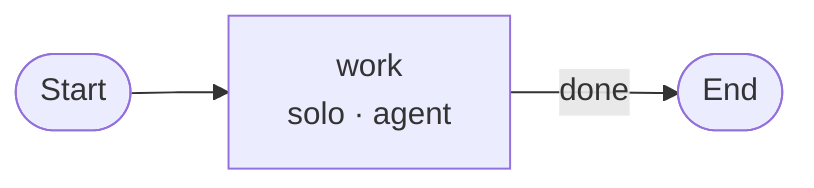
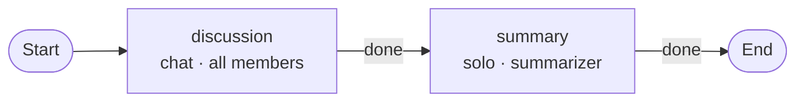
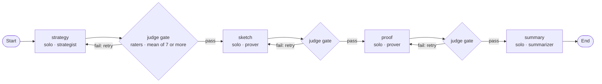
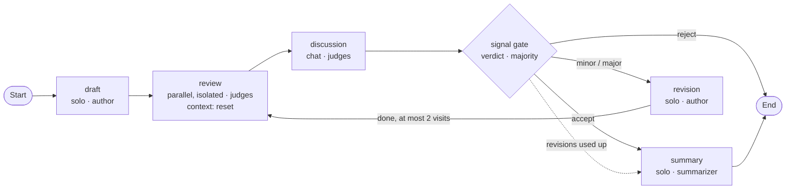
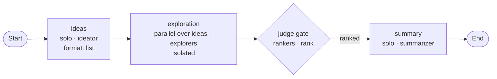

# Research groups: agents, phases, actions and gates

> **Status: design.** Today `arr` ships five fixed group types (`solo`, `roundtable`, `waterfall`, `review`, `exploration`). This document describes the model they are being rebuilt on, so that you can compose your own groups from the same parts. It records where the design is going, not what the code does today. The YAML shown here is a sketch; key names may still change.

## The idea

A research group is a set of **agents** and a list of **phases**. Each phase says who takes part, what each agent has to do, who can talk to whom, and when the run moves on.

```
Run
├── Agents        who: engine, model, rights, role
├── Channels      how messages travel: group chat or direct channel
├── Folders       how files travel: work folders and the results folder
└── Phases        in order, connected by routes
    ├── Topology  solo | parallel | chat | moderated
    ├── Agents    with an action · on standby · not taking part
    ├── Actions   for each agent a task and a submission
    ├── Context   keep | reset | compact
    ├── Channels  which ones are open in this phase
    └── Gate      when the phase ends and where the run goes: done | signal | judge | user
```

Every agent works the same way. It gets an **action**: a task that says what to do, and a submission that it hands in at the end, in a format `arr` can read. A summarizer, a judge or a rater is not a special kind of agent. It is an agent whose action asks for a particular submission.

## Agents and roles

An agent has an `id`, an engine (Claude or ChatGPT; in the group file `provider: claude` or `provider: codex`), a model, its rights (tools, web, read folders, work folder) and a **role**. The role is a short, static text: who the agent is and what standard it applies. What the agent does in a given phase is not part of the role. That is the action.

## Actions

An **action** is what one agent does in one phase. It has two parts:

| Part | What it is | Example |
|---|---|---|
| **Task** | what the agent is asked to do | "Check the proof step by step. Write down every gap as an objection." |
| **Submission** | what the agent hands in at the end, in a format `arr` checks | a `review`: a verdict and a list of objections |

The task is for the agent. The submission is for everything that comes after it: gates, overviews and the inputs of later phases read submissions, never free text.

### Task

The task is a text file in the group (`tasks/<name>.md`). It says what to do in this phase, while the role says who the agent is. `arr` adds the context: the research question of the run, the phase, the inputs from earlier phases and, on a retry, the feedback.

An action can take several turns. If a turn ends without a submission, for example because the agent is waiting for a long computation, `arr` starts the next turn of the same action. The number of turns per action is limited.

### Submission

The agent hands in its submission through a tool. `arr` checks the fields at once. If they do not fit, the agent gets an error and corrects them, so a submission always has valid fields. The check is about the form, not the quality: "not solved" is a submission, and so is a proof that later fails a gate.

If the agent stops without a submission, or the turns of the action are used up, `arr` asks once. After that the action counts as `not_solved`.

Every submission has the same head:

| Field | Content |
|---|---|
| `status` | `done` or `not_solved`. "Not solved", with a reason, is a valid submission. |
| `summary` | One to three sentences. Used in overviews, by gates and as the default input of later phases. |
| `body`, `files` | The content itself: text, files from the agent's work folder, or both. |
| `note_next` | Optional note to the agent's future self, used when its context is compacted. |

The format adds its own fields:

| Format | Extra fields | Used for |
|---|---|---|
| `text` | – | notes, summaries |
| `artifact` | none, but `files` are required | a proof, a script, a data set |
| `review` | `verdict` (`accept`, `minor`, `major`, `reject`), `objections` | judges |
| `rating` | `score`, `criteria`, `comment` | raters, rankers |
| `list` | `items` | a list of ideas |
| `decision` | `choice` from the options the phase names | branching |

A submission can have a **name** (`name: proof`). Submissions under the same name are versions of the same thing: `arr` keeps every version, writes a diff from the second one on, and later phases always get the newest.

## Folders

Messages travel through channels. Files travel through folders. A run has these kinds:

| Folder | What it is | Who writes | Who reads | How long it lives |
|---|---|---|---|---|
| **Material** | the project as it was when the run started. Per agent also the read folders you allowed. | nobody | every agent; a read folder only the agents it is set for | the run |
| **Work folder** | the desk of one agent: notes, scripts, drafts | that agent | only that agent | until the agent gets a fresh one |
| **Scratch folder** | throwaway data of one agent: downloads, intermediate results | that agent | only that agent | until the agent gets a fresh work folder, at the latest until the run ends. Then it is deleted. |
| **Results folder** | every submission of the run | only `arr` | every agent, and you | as long as you keep the run |

Every agent has exactly one work folder at a time. It starts as a copy of the project or empty. Several agents can also have one work folder in common, a **shared folder**: a desk for agents that work on the same files. A shared folder lives for the whole run. It fits agents that build on each other's files and talk to each other, for example one that writes a script and one that tests it. Agents that should work independently keep their own folders and exchange submissions. Today a shared folder is for agents of one engine only (see [SECURITY.md](../SECURITY.md)).

Agents never write into the results folder. When an agent submits, `arr` copies the files the submission names from the work folder into the results folder. What lies there is not changed afterwards: a new version is added next to the old one. A submission that fails a gate stays there too.


A file gets from one agent to another in three ways:

| Way | Used for |
|---|---|
| in a **submission** | the normal way. `arr` checks it and keeps versions, and an isolated phase holds it back until the phase ends. |
| as an **attachment** to a message | a quick exchange in a channel. `arr` stores it with the channel, and only the members of the channel can read it. |
| through a **shared folder** | several agents edit the same files. Not allowed between the agents of an isolated phase. |

An agent can never open another agent's work folder or scratch folder.

### Folders that expire

A work folder does not have to last for the whole run. A phase can give an agent a **fresh** work folder: a new copy of the project, or a new empty folder. Two things then happen to the old one:

- `arr` **retires** the work folder. No agent can read a retired folder, not even the agent that worked in it. It stays in the record of the run, with a diff of what the agent changed, until you slim the run.
- `arr` **deletes** the scratch folder. Nothing of it is kept.

Transcripts are record as well: an agent cannot read its own.

So the rule for agents is simple: **work folders expire, submissions stay.** What an agent wants to keep, it hands in. What nobody needs afterwards belongs in the scratch folder.

By default the work folder follows the `context` setting of the phase (see [Context](#context)): `reset` gives a fresh folder, because notes on the desk are memory too, and `keep` and `compact` leave the folder alone. A phase can set the two apart with `folder: keep` or `folder: fresh`:

| Setting | Effect | Example |
|---|---|---|
| `context: reset` | new session, fresh folder | A judge reviews the second version of a proof. Its private notes from the first review are gone. What it handed in is still in the results folder. |
| `context: reset`, `folder: keep` | new session, same folder | A prover starts over after a long computation and keeps its scripts and data. |
| `folder: fresh` | same session, fresh folder | A worker on standby gets ten computations from a lead. It remembers what it learned, but every computation starts in a clean folder. |

A shared folder never becomes fresh, because that would take the work away from the others. For an agent in a shared folder, `reset` renews only the session.

After the run, slimming deletes the work folders, retired folders and the copy of the project. The results folder, the transcripts, the chats with their attachments and the diffs stay. Nothing flows back into your project by itself: you take over what you want from the results folder.

## Phases

### Topology

| Topology | What happens | Example |
|---|---|---|
| `solo` | One agent with one action. | A prover writes a proof. |
| `parallel` | Several agents, each with its action, at the same time. With `isolated: true` they see each other's submissions only after the phase, and the channels they share are closed. With `over: <list>`, `arr` deals the entries of a list out to them, one action per entry. | Judges review independently. |
| `chat` | The agents discuss in a channel, in rounds or event-driven. When the discussion ends (the rounds are used up, or the channel has fallen silent), each one submits. | Judges discuss their reviews. |
| `moderated` | One lead has the action. The others are on standby. The lead hands out actions at run time: it writes the task and names the format of the submission. The submissions go back to the lead, and the phase ends with the lead's own submission. | A coordinator splits a problem into computations. |

An agent works on one action at a time. If it has several in one phase, for example three entries of a list or five actions from a lead, it does them one after the other.

### Who takes part

In each phase an agent is one of three things:

- **With an action:** it has a task and must submit.
- **On standby (a sleeper):** it has no action of its own. It wakes up when someone addresses it through a channel or a lead hands it an action, does that, and sleeps again. It never holds up the end of the phase.
- **Not taking part:** it gets no turn and no messages.

### Inputs

Inputs are what the agents of a phase get from earlier phases. By default these are the research question of the run and, for every submission so far, its summary and its place in the results folder. A phase can choose differently: only certain phases or names, the full text instead of the summary, the history of a channel, or the best-rated submission of a phase.

Inputs decide what `arr` puts in front of an agent. They are not a wall: every agent of the run can read the results folder, except for submissions that an isolated phase still holds back.

### Channels

A group defines its channels once: a group chat with several members or a direct channel between two agents. Each phase names the channels that are open. A message in an open channel wakes a sleeper and reaches a working agent as a hint.

### Context

| Value | Session | Work folder |
|---|---|---|
| `keep` (default) | continues. The agent remembers everything. | stays |
| `reset` | new. The agent gets only its role, the action and the inputs. | fresh |
| `compact` | new, and starts with the agent's own `note_next`. | stays |

`context` and `folder` are set on a phase, for all its agents or for single ones. They apply at the start of each action, also of one that a lead hands out. On a `retry` the agent continues with its session and its folder. [Folders that expire](#folders-that-expire) explains the fresh work folder.

Independently of phases, `arr` measures how full each agent's context is. Above a threshold set per agent, it asks the agent for a handover note between two turns and starts a new session. `arr` restores what it knows itself: role, action, inputs, the agent's own submissions and unread messages. This renewal never touches the folders.

## Gates and routes

The **gate** of a phase decides when the phase ends and where the run goes next. It reads fields of submissions.

| Gate | Who decides | Results | Example |
|---|---|---|---|
| `done` (default) | Nobody. The phase ends when every agent with an action has submitted. | `done` | a summary |
| `signal` | The agents themselves, through a field of their submission. With several agents a rule applies (`all`, `any`, `majority`, `unanimous`). | the values of the field | A prover reports `not_solved`, and the run goes back to the strategy. |
| `judge` | Agents that did not take part in the phase. After the work each of them gets a rating action for every submission of the phase. A rule turns their submissions into a result (`mean >= 7`, `majority`, `rank`). | `pass` or `fail` for a threshold, `ranked` for `rank`, the verdict for `majority` | Two raters score a proof sketch. |
| `user` | You. The run pauses and shows you the summaries. | the route you choose | You look at the strategy before the prover starts. |

If a rule finds no majority, the stricter value counts: one judge says `accept` and one says `minor`, so the result is `minor`.

The names can mislead. In the `review` template the judges are ordinary agents of the phase, and a `signal` gate reads their verdicts. A `judge` gate brings in agents from outside the phase:

```yaml
gate:
  judge: [rater-*]
  action: { task: tasks/rate.md, submission: { format: rating } }
  rule: mean >= 7
  routes: { pass: next, fail: retry }
```

Each result of a gate has a **route**:

| Route | Effect |
|---|---|
| `next` | the next phase in the list |
| `retry` | the same phase again. The agents get the feedback: the comments of the raters or the objections of the judges. |
| `goto: <phase>` | another phase, forward or back. Its inputs include the submissions that led there, for example the reason of a `not_solved`. |
| `stop` | the run ends with what it has |
| `escalate` | you decide, as with the `user` gate, but only in this case |

Every loop is bounded. A phase in a loop has a maximum number of visits (`max_visits`); the first visit and every retry count. If a route leads into a phase whose visits are used up, the run takes the route `on_exhausted` of that phase instead. `arr` rejects a group in which a loop has no limit.

## The five built-in groups

The five group types become templates built from these parts. In the diagrams a box is a phase (name, topology, who), a diamond is a gate, and an arrow is a route.

### solo

One agent works on the research question.



### roundtable

All agents discuss in one channel, then one of them writes the summary.



### waterfall

Stages in order. Raters score each stage, and below the pass score its author reworks it. Retries are limited; after that the group continues, stops or asks you.



### review

Independent judges review a draft, discuss and reach a verdict. The author revises until the judges accept or the revisions are used up.



### exploration

An ideator proposes ideas, explorers work them out separately, rankers order the results.



## A custom group

The same parts combine into groups that fit a problem. Here you check the ideas before the explorers start, the prover can ask a strategist on standby, and judges review the proof:


## What a group file looks like

The `review` template as a sketch:

```yaml
kind: research-group

agents:
  - { id: author, role: roles/author.md, model: claude-opus-5-5 }
  - { id: judge, role: roles/judge.md, count: 2,                 # judge-1, judge-2
      mix: [{ provider: claude }, { provider: codex }] }
  - { id: summarizer, role: roles/summarizer.md, model: claude-haiku-5-5 }

channels:
  - { name: judges, members: [judge-*], mode: rounds, anonymous: true }

phases:
  - name: draft
    topology: solo
    actions:
      author: { task: tasks/draft.md, submission: { format: artifact, name: proof } }

  - name: review
    topology: parallel
    isolated: true
    context: reset                 # new session and a fresh work folder
    actions:
      judge-*: { task: tasks/review.md, submission: { format: review } }

  - name: discussion
    topology: chat
    channels: [judges]
    rounds: 1
    actions:
      judge-*: { task: tasks/discuss.md, submission: { format: review } }
    gate:
      signal: verdict
      rule: majority
      routes:
        accept: { goto: summary }
        minor: { goto: revision }
        major: { goto: revision }
        reject: stop

  - name: revision
    topology: solo
    max_visits: 2
    actions:
      author: { task: tasks/revise.md, submission: { format: artifact, name: proof } }
    on_exhausted: next             # third revision asked for: go on to the summary
    gate: { routes: { done: { goto: review } } }

  - name: summary
    topology: solo
    actions:
      summarizer: { task: tasks/summarize.md, submission: { format: text } }
```

Each entry under `actions` is one action: the agent, its task and its submission.

`arr` checks a group file before every start and reports errors with the path, the reason and a suggestion, for example a route to a phase that does not exist or a loop without a limit.

## The supervising agent

The supervising agent is not part of any phase. It has no role, no action and no channel. For the whole run it decides the agents' permission requests within the mandate you wrote, for example a single `pip install` from PyPI. Everything else goes to you or is denied. You set it in the settings of your `arr` workspace (`arr.yaml`) or per run, outside the phases:

```yaml
approvals:
  decider: gatekeeper_then_user   # user | gatekeeper | gatekeeper_then_user
  gatekeeper: { model: claude-haiku-5-5, mandate: mandates/standard.md }
```

Three things sound alike and are different:

| Who | Decides | Where it is set |
|---|---|---|
| Supervising agent | whether an agent **may** do something, within your mandate | `approvals`, per workspace or run |
| `judge` gate | whether a result is **good enough**, and where the run goes | the gate of a phase |
| You | run starts, anything outside the mandate, agents' questions, the `user` gate | the inbox in the web interface |

## Limits of the model

The model is small on purpose. It cannot express the following:

| Limit | Meaning | What to do instead |
|---|---|---|
| One phase at a time | Agents work side by side inside a phase, but two phases never run at the same time. | Put both jobs into one `parallel` phase. They then share its gate. |
| No nesting | A phase cannot contain a group, and an agent on standby cannot hand out actions itself. | One `moderated` phase per level. |
| Fixed cast | All agents are set up before the run starts. A run cannot add agents. | `over` deals a list out to the agents that exist. |
| Agents are named in the plan | A phase names its agents. It cannot say "the author of the best attempt revises it". | A fixed agent takes over the best attempt as its input. |
| No teams | Two sub-groups cannot discuss separately in the same phase without seeing each other's results. | One `chat` phase per team, one after the other. The second team could still look up the results of the first (see [Inputs](#inputs)). |
| One model per agent | An agent keeps its engine and its model for the whole run. | Two agents. The second gets the submission of the first. |
| Rights per run | Tools, web access and read folders are set per agent for the whole run, not per phase. | – |
| No machine check as a gate | Gates read submissions. `arr` does not run a proof checker or a test itself. | An agent runs the check and reports the result in its submission. |

## What does not change

Phases change the order of work, not the walls around it. Each agent runs in its sandbox and cannot read other agents' work folders. Work is exchanged only through channels, submissions and the shared folders the group names. Approvals, limits, the budget and the kill switch apply to the whole run. See [SECURITY.md](../SECURITY.md).
